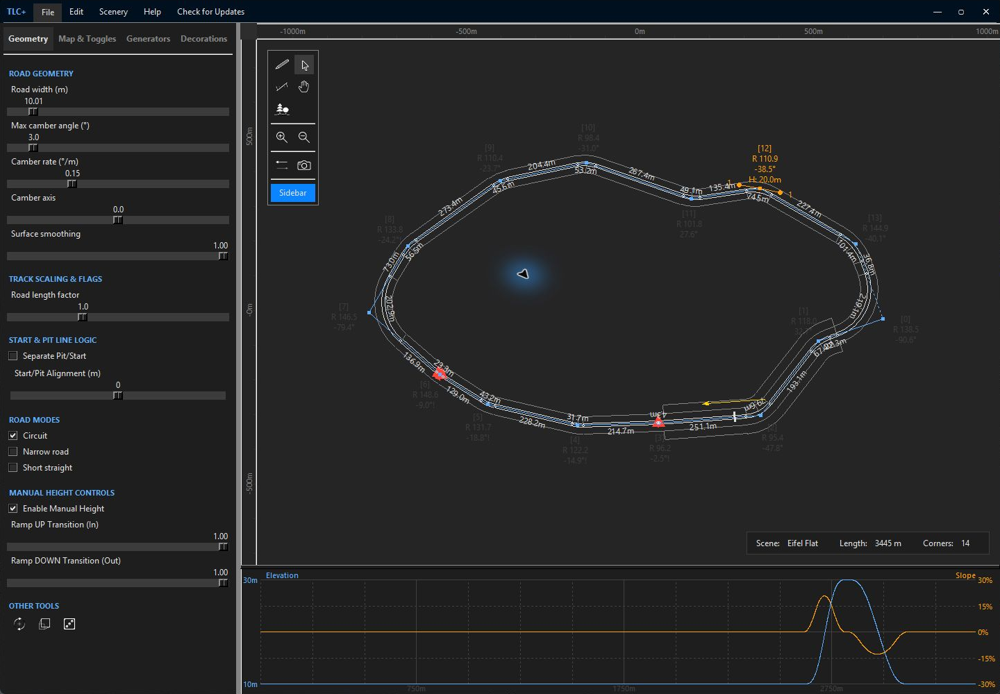

# Your first track

Build a small circuit, make one edit, save the geometry and export a TED. Start with [installation](installation.md) complete and an empty editor.

## 1. Choose scenery and generate a layout

Choose **Eifel Flat** from the scenery menu for an easy first project. Open **Generators** and click **Grand Prix (Fast & Flowing)**. Each click replaces the current layout, so save existing work before experimenting.

{ .tlc-shot }

*v1.2.0 screenshot; the basic layout workflow also applies to v1.3.0.*

Leave **Circuit** enabled on the Geometry tab for a closed loop. For a Rally Stage, disable Circuit before generating.

## 2. Move a corner

Choose **Selection**, click a control node and drag it. Zoom with the wheel; right-drag empty canvas to pan; press ++c++ to centre the track. Right-dragging a node can change its radius, so start panning away from nodes.

Double-click a node, or select it and press ++enter++, to enter precise coordinates, radius, height and camber. Use ++ctrl+z++ to undo a geometry edit. [All tools and controls →](../interface/toolbar.md)

## 3. Check road width, start and elevation

On **Geometry**, try a modest road width and inspect the resulting corners. Check the start line and pit markers. Keep your first track on flat terrain; introduce manual heights only after you understand the [elevation controls](../concepts/elevation-terrain.md).

Inspect sharp corners, overlaps and canvas warnings. A successful export does not establish that a layout will drive correctly in GT6.

## 4. Save the editable geometry

Choose **File → Save track** or press ++ctrl+s++. Save a `.trk5` and note its location. Use another filename for each milestone.

!!! warning "A TRK5 is not a complete session backup"
    v1.3.0 saves the nodes and a subset of track settings. It omits decorations, reference paths, undo history and several elevation/session controls. Keep notes of those settings and export a TED after decorating. [What saves preserve →](../files/saving-loading.md#what-a-trk5-preserves)

## 5. Add a few decorations

Open **Decorations**, choose an item from the current scenery's palette and activate the **Decoration tool**. Click beside the road to place it. Drag an item along the track; use **Flip Side** or **Randomize Variant** when appropriate.

Choose scenery before decorating: confirming a switch to another scenery clears placed decorations. [Decoration workflow →](../interface/decorations.md)

## 6. Export a TED

Choose **File → Export to TED**, select an output location and confirm. Keep the `.ted` beside the `.trk5`. Export needs at least **three nodes for a circuit** or **two for an open stage**.

The TED carries the final road, sampled elevation, banking and supported decoration records. It is an output format; re-importing it reconstructs an approximation of your editable road. [Export details and limits →](../files/exporting.md)

## 7. Review before closing

Open **File → Draw isometric view**. Rotate, pan and zoom to check the road and terrain. v1.3.0 adds vertical camera tilt while rotating. Use the main toolbar's screenshot action to save an image; the File menu still calls this **Export to PostScript**, but the main canvas normally saves PNG.

Check that both your `.trk5` and `.ted` exist. Do not close the editor expecting an automatic session recovery. Exporting does not transfer a course to a console; use a separate workflow supported by your own GT6 setup.

Next: [trace GPS data](../generators/gps-tracing.md), [trace an image](../generators/image-vectorizer.md), or explore [geometry](../concepts/track-geometry.md).
