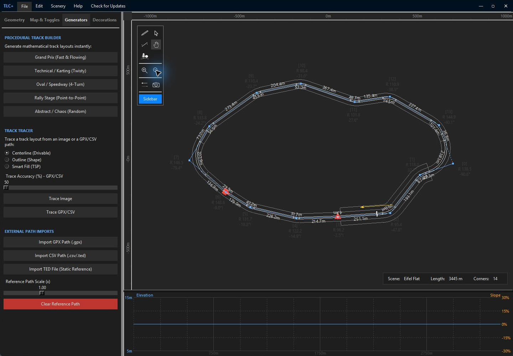

# Generators & Track Tracer

The **Generators** tab contains three independent modules. Preferences can hide each module, or the whole tab when none are enabled.

{ .tlc-shot }

| Module | Result | Read more |
| --- | --- | --- |
| Procedural Track Builder | A new editable layout from a preset | [Procedural builder](../generators/procedural.md) |
| Track Tracer: Trace Image | Editable nodes from a track image | [Image tracing](../generators/image-vectorizer.md) |
| Track Tracer: Trace GPX/CSV | Editable nodes from a GPS route | [GPS tracing](../generators/gps-tracing.md) |
| External Path Imports | A reference overlay; current polygon stays in place | [Importing](../files/importing.md) |

Save current geometry and export decorations before generating/tracing a replacement road. Recheck placed scenery after geometry changes.

## Procedural Track Builder

Choose **Grand Prix**, **Technical / Karting**, **Oval / Speedway**, **Rally Stage**, or **Abstract / Chaos**. The result is editable, so remove unhelpful nodes and refine corners instead of accepting every generated point. Turn Circuit off before building a Rally Stage; the experimental override is not the recommended first workflow.

## Track Tracer

The image modes are **Centerline (Drivable)**, **Outline (Shape)** and **Smart Fill (TSP)**. Choose one, then use **Trace Image**.

For GPS, set **Trace Accuracy (%) - GPX/CSV** (50–100%), then use **Trace GPX/CSV**. The image radio buttons do not affect GPS tracing, and the GPS accuracy slider does not affect image tracing.

## External Path Imports

Use **Import GPX Path**, **Import CSV Path** or **Import TED File (Static Reference)** to draw an overlay. **Reference Path Scale (x)** changes its displayed scale from 0.01 to 3.0; `1.0` is the original projected size. **Clear Reference Path** removes the overlay.

The CSV button's v1.3.0 label mentions `.csv/.ted`, but its picker is for CSV; use the dedicated TED actions for TED files. A reference overlay is not part of a TED export or a TRK5 save.
